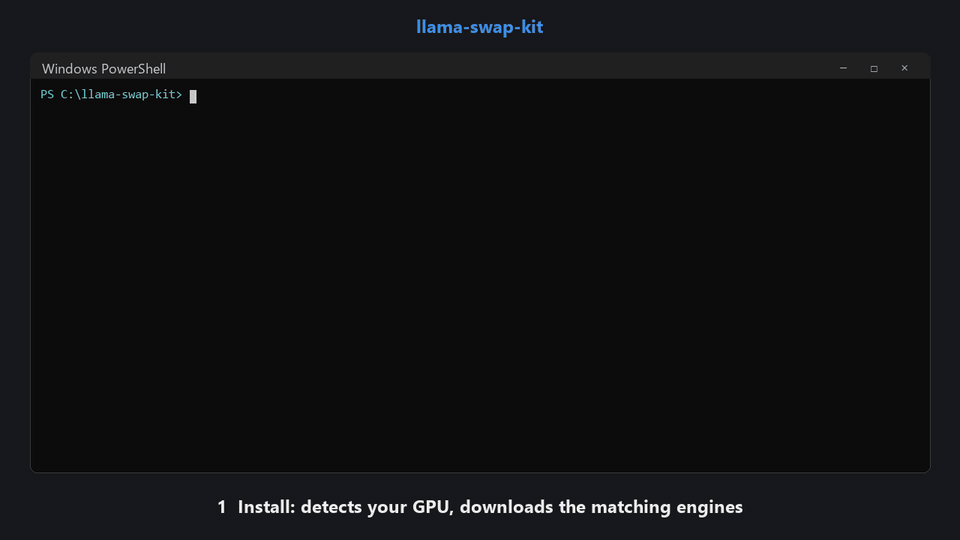

# llama-swap-kit

**A Windows-native, one-command local AI stack.** Chat, vision, image generation, speech-to-text and
text-to-speech behind **one OpenAI-compatible endpoint**. It sizes itself to your PC, even a 4 GB laptop GPU.

No Docker, no system Python, no CUDA toolkit, no admin rights. Two commands and any OpenAI-compatible app can
use `http://127.0.0.1:8080/v1`.



<sub>Real output on an RTX 3050 Laptop (4 GB). Waits are sped up and labeled. [Watch with sound (MP4)](docs/demo.mp4): the
voice is the actual Kokoro text-to-speech output.</sub>

Built on [llama-swap](https://github.com/mostlygeek/llama-swap), which does the model swapping. This kit adds
what you'd otherwise do by hand: installing the right backend builds for your GPU, finding, downloading and
converting models, estimating how much memory each needs, and keeping the config in sync.

---

## Why

Running several local models on a normal PC is fiddly. Each model type needs a different engine (llama.cpp,
stable-diffusion.cpp, whisper.cpp, audio.cpp), each engine ships different builds per GPU, and on a small GPU
only one model fits at a time. You end up juggling ports, DLL conflicts and YAML.

llama-swap-kit turns that into:

```powershell
powershell -ExecutionPolicy Bypass -File scripts\setup.ps1
powershell -ExecutionPolicy Bypass -File start.ps1
```

## Features

- **One endpoint for everything:** `/v1/chat/completions`, `/v1/audio/speech`, `/v1/audio/transcriptions`,
  `/v1/images/generations`, `/v1/embeddings`. Models load on demand and unload when idle or when another
  model needs the memory.
- **Fits your hardware automatically:** detects the GPU and RAM, installs the CUDA (NVIDIA), Vulkan (AMD/Intel)
  or CPU build, and sizes the memory budget. Re-detects on every start, so the folder can be copied to another PC.
- **Model manager:** `manage.ps1 add <huggingface-repo>` identifies what a model is by reading its file header
  (nothing is downloaded until it's identified), picks a sensible quantization, downloads it, converts
  Transformers LLMs to GGUF when needed, estimates its memory and registers it.
- **Roles instead of model names:** apps ask for `agent`, `chat`, `tts`, `stt`, `image`... Swap the model
  behind a role with one command and no app changes. Ideal for building agents and tools on top.
- **Verified contract:** `manage.ps1 check` tests every role end to end (including a real tool call and a
  TTS -> STT round trip), so you know the stack works after any change.
- **Escape hatch for anything else:** models no engine supports run as Python workers (one isolated `uv`
  environment each), started and stopped like the native engines. Python TTS models get a worker that serves
  the standard speech endpoint, so they can replace the default voice (see
  [docs/adding-models.md](docs/adding-models.md#speech)).
- **Web UI** (from llama-swap) at `/ui`: playground, live logs, loaded models.

## Requirements

- Windows 10 (1803+) or 11, x64. `curl.exe` and `tar.exe` are built in.
- About 4 GB of disk for the engines, plus your models.
- A GPU is optional:
  - **NVIDIA:** CUDA build. Needs a driver with CUDA 12 support (R528+); no CUDA toolkit needed.
  - **AMD / Intel with 3+ GB dedicated VRAM:** Vulkan build.
  - **Anything else:** CPU build (slower, but everything works).

## Quick start

**1. Install** (downloads the engines that suit your GPU, plus Whisper and Kokoro voice models; about 4 GB):

```powershell
git clone https://github.com/chaoticrs/llama-swap-kit
cd llama-swap-kit
powershell -ExecutionPolicy Bypass -File scripts\setup.ps1
```

**2. Add a chat model.** Qwen3 4B at Q4_K_M (2.3 GB) fits a 4 GB GPU and supports tool calling:

```powershell
.\manage.ps1 add unsloth/Qwen3-4B-Instruct-2507-GGUF
```

The first LLM you add automatically becomes the `chat` and `agent` roles.

**3. Start it:**

```powershell
powershell -ExecutionPolicy Bypass -File start.ps1
```

Open http://127.0.0.1:8080/ui for the web UI, or point any OpenAI-compatible app at `http://127.0.0.1:8080/v1`
(any API key works).

**4. Check everything works** (in a second terminal):

```powershell
.\manage.ps1 check
```

## Using the API

Always ask for a **role** (`chat`, `agent`, `tts`, `stt`, `image`, ...), not a model file. See
[CONTRACT.md](CONTRACT.md) for every role and guarantee.

**Python** (`pip install openai`):

```python
from openai import OpenAI
ai = OpenAI(base_url="http://127.0.0.1:8080/v1", api_key="local")

# chat
r = ai.chat.completions.create(model="chat", messages=[{"role": "user", "content": "Hello!"}])
print(r.choices[0].message.content)

# text to speech -> hello.wav
ai.audio.speech.create(model="tts", voice="af_heart", input="Hello there").write_to_file("hello.wav")

# speech to text
print(ai.audio.transcriptions.create(model="stt", file=open("hello.wav", "rb")).text)

# image (base64 PNG in r.data[0].b64_json)
r = ai.images.generate(model="image", prompt="a lighthouse at dusk, watercolor", size="512x512")
```

**Tool calling** with the `agent` role works the standard OpenAI way (`tools=[...]`, read
`message.tool_calls`). Give it a generous `max_tokens`: reasoning models think before calling a tool.

**PowerShell** (in Windows PowerShell `curl` is an alias for `Invoke-WebRequest`, so use `Invoke-RestMethod`):

```powershell
$api = 'http://127.0.0.1:8080'
(Invoke-RestMethod "$api/v1/chat/completions" -Method Post -ContentType 'application/json' `
  -Body '{"model":"chat","messages":[{"role":"user","content":"Hello"}]}').choices[0].message.content

Invoke-RestMethod "$api/v1/audio/speech" -Method Post -ContentType 'application/json' `
  -Body '{"model":"tts","input":"Hello there","voice":"af_heart"}' -OutFile hello.wav

curl.exe -s "$api/v1/audio/transcriptions" -F model=stt -F file=@hello.wav
```

**Kokoro voices** set the language: `af_*`/`am_*` US English, `bf_*`/`bm_*` UK English, `hf_*`/`hm_*` Hindi,
`jf_*` Japanese, `zf_*` Chinese, `ef_*` Spanish, `ff_*` French, `if_*` Italian, `pf_*` Portuguese. Full list:
`GET /v1/audio/voices?model=tts`.

## Managing models

```powershell
.\manage.ps1 list                                  # models, memory estimates, roles
.\manage.ps1 inspect <hf-repo | file>              # what is it? which engine? (downloads nothing)
.\manage.ps1 add <hf-repo | file> [options]        # download / convert / register
.\manage.ps1 remove <id> [--delete-files]
.\manage.ps1 role                                  # list roles
.\manage.ps1 role agent <model-id>                 # point a role at another model
.\manage.ps1 check [--all]                         # test the running stack (--all includes image)
.\manage.ps1 detect                                # re-size to this PC (start.ps1 does this)
```

Common `add` options: `--quant Q8_0`, `--file <exact file>`, `--id <name>`, `--cpu`, `--always-on`,
`--ttl <seconds>`, `--args "-c 16384"`, `--mmproj <projector.gguf>` (vision), `--vram/--ram <MiB>` (override
the estimate), `--worker`. Gated Hugging Face repos need `HF_TOKEN` set.

More in [docs/adding-models.md](docs/adding-models.md): every model type, local files, vision, image
models that need extra files, and Python workers.

## How it works

```
your app --HTTP--> llama-swap :8080 --starts/stops--> llama-server   (LLMs, vision)
                     |  routes by "model"              sd-server      (image, video)
                     |  evicts by VRAM/RAM budget      whisper-server (speech to text)
                     |                                 audiocpp_server (text to speech, ASR)
                     |                                 Python workers (everything else)
models/registry.json --manage.py--> config/llama-swap.yaml (generated)
```

The registry is the only source of truth: `manage.py` turns it into llama-swap's config, and `start.ps1`
regenerates that on every start. Details: [docs/how-it-works.md](docs/how-it-works.md).

## Building on top

This kit is meant to be the inference layer for bigger local projects: voice assistants, MCP tool servers,
agents, screen overlays. Talk to it only through [CONTRACT.md](CONTRACT.md) (roles, endpoints, timing,
errors). Anything not in the contract may change, and `manage.ps1 check` tells you when something you
depend on breaks.

## Troubleshooting

See [docs/troubleshooting.md](docs/troubleshooting.md). The usual suspects: the first request to a model
is slow while it loads (up to minutes for big image models), a model too big for your GPU (use a smaller
quant or `--cpu`), or port 8080 already in use (change `listen` in `models/registry.json`).

## How it compares

| | llama-swap-kit | llama-swap alone | Ollama / LM Studio |
|---|---|---|---|
| Chat LLMs | yes | yes | yes |
| Image, STT, TTS in the same endpoint | yes, installed and wired | yes, if you install and configure each engine | chat only (mostly) |
| Picks GPU builds + memory budget for you | yes | no | yes |
| Hugging Face model manager / converter | yes | no | own model library |
| Platforms | Windows only (for now) | Linux, macOS, Windows | all |

If you're on Linux/macOS or want full control of the config, use llama-swap directly. If you only need chat,
Ollama or LM Studio are simpler. This kit is for Windows users who want the whole multimodal stack working
together with minimal setup.

## Credits

This repo contains only scripts and docs. `setup.ps1` downloads each project's official release binaries,
which keep their own licenses:
[llama-swap](https://github.com/mostlygeek/llama-swap) (MIT),
[llama.cpp](https://github.com/ggml-org/llama.cpp) (MIT),
[stable-diffusion.cpp](https://github.com/leejet/stable-diffusion.cpp) (MIT),
[whisper.cpp](https://github.com/ggml-org/whisper.cpp) (MIT),
[audio.cpp](https://github.com/0xShug0/audio.cpp) (Apache-2.0),
[uv](https://github.com/astral-sh/uv) (MIT / Apache-2.0),
[eSpeak NG](https://github.com/espeak-ng/espeak-ng) (GPL-3.0).
Models keep their own licenses; check each model card.

## License

[MIT](LICENSE)
